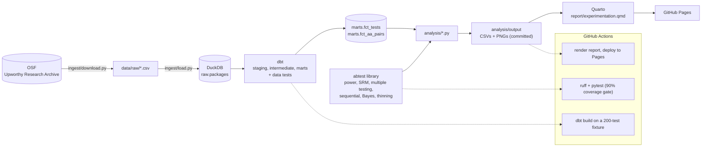

# experimentation-at-scale

[](https://github.com/khus-hi/experimentation-at-scale/actions/workflows/ci.yml)
[](https://github.com/khus-hi/experimentation-at-scale/actions/workflows/report.yml)

**When you run thousands of A/B tests, how many winners are real, and how inflated are their lifts?**
Answered on 32,487 real headline experiments from the Upworthy Research Archive.

**Read the report: [khus-hi.github.io/experimentation-at-scale](https://khus-hi.github.io/experimentation-at-scale/)**

## Three findings

1. **Only 7.3% of 5,917 declared winners hold up.** After Holm correction inside each test and
   Benjamini-Hochberg across 25,349 clean tests, 434 winners survive; in 1,643 tests the declared
   winner did not even have the highest click rate.
2. **Winners overstate their lift by 129%.** Picked on one random half of the traffic, the best
   arm beats the rest by 57.8%; on the other half the same arm beats it by 22.1%. Empirical Bayes
   shrinkage predicts the held-out lift with 65% less error (calibration slope 1.02 vs 0.56).
3. **No clean test was powered for a 10% lift.** The median test could detect only an 89% lift,
   and SRM failed in 69.7% of tests inside the known randomization bug window vs 0.5% outside.

Also: peeking daily for 10 days turns a 5% false positive rate into 19.0% (O'Brien-Fleming keeps
it at 4.7%), and question headlines get 9.8% fewer clicks than other arms of the same test.

## Architecture



CI never touches OSF: tests run on a committed 200-test sample of the archive, and the Pages site
renders from the committed CSVs and figures.

## Reproduce

Needs Python 3.11+ and [Quarto](https://quarto.org/docs/get-started/) (free; on macOS
`brew install --cask quarto`).

```bash
git clone https://github.com/khus-hi/experimentation-at-scale
cd experimentation-at-scale
make all PYTHON=python3
open report/experimentation.html
```

`make all` runs, in order:

| target | what it does |
| --- | --- |
| `make setup` | creates `.venv` and installs the package with dev and report extras |
| `make ingest` | downloads the archive from OSF into `data/raw/` and loads `raw.packages` in `data/upworthy.duckdb` |
| `make build` | `dbt build`: models plus data tests, then a summary by year and arm count |
| `make test` | pytest and ruff |
| `make analysis` | `srm`, `peeking`, `shrinkage`, `portfolio`, `findings`, `winners-curse`, `winners-curse-doc`: writes `analysis/output/` and `docs/*.md` |
| `make report` | renders `report/experimentation.qmd` to `report/experimentation.html` |

Every analysis is seeded, so a fresh run reproduces the committed CSVs. Long-form write-ups:
[docs/portfolio_findings.md](docs/portfolio_findings.md) and
[docs/winners_curse.md](docs/winners_curse.md).

dbt models (DuckDB schemas `staging`, `intermediate`, `marts`):

| model | grain |
| --- | --- |
| `stg_packages` | one row per package (arm), types cleaned, `ctr`, `randomization_risk` |
| `int_test_arms` | exact duplicates removed, arms numbered within a test, identical arms flagged |
| `fct_tests` | one row per test: arms, impressions, best/worst ctr, Upworthy's winner, A/A flag |
| `fct_aa_pairs` | every pair of identical arms in a test (natural A/A tests) |

## The `abtest` library

Pure functions on counts that return frozen dataclasses; no pandas in the math. Checked against
statsmodels where it has an equivalent.

| module | what |
| --- | --- |
| `abtest.proportions` | pooled two-proportion z-test, Wilson and Newcombe intervals, relative lift with a delta-method CI, chi-square omnibus and every arm vs a control |
| `abtest.power` | sample size per arm, minimum detectable effect, achieved power; k arms with Bonferroni `alpha / (k - 1)` |
| `abtest.srm` | sample ratio mismatch: chi-square goodness of fit, flagged at p < 0.001 |
| `abtest.multiple` | Bonferroni, Holm, Benjamini-Hochberg, Benjamini-Yekutieli, Storey's pi0, within-test and portfolio corrections, winner survival |
| `abtest.sequential` | peeking simulator: naive peeking, O'Brien-Fleming alpha spending, always-valid mSPRT |
| `abtest.bayes` | Beta-binomial P(best) and expected loss, empirical Bayes shrinkage (normal or spike + normal prior) |
| `abtest.thinning` | data thinning: split each arm into independent halves to pick on one and measure on the other |

```python
from abtest.bayes import shrink_best_arms, winners_curse
from abtest.multiple import adjust
from abtest.power import sample_size_per_arm
from abtest.proportions import multi_arm_test
from abtest.srm import srm_check

print(sample_size_per_arm(baseline=0.013, relative_mde=0.10).n_per_arm)  # 124,989 per arm
clicks, imps = [41, 52, 38], [3021, 2987, 3050]
print(srm_check(imps).srm, multi_arm_test(clicks, imps).p_value)  # split OK? any difference?
print(adjust([0.001, 0.02, 0.04, 0.30], method="bh").reject)  # FDR across a roadmap
print(winners_curse(shrink_best_arms([(clicks, imps), ([30, 44], [2500, 2490])], "normal")))
```

**Skills shown:** SQL, dbt, pytest, CI/CD, power analysis, SRM, multiple testing, sequential
testing, Bayesian A/B testing, empirical Bayes, winner's curse.

## Data

[The Upworthy Research Archive](https://upworthy.natematias.com/), licensed CC BY 4.0. The
randomization-risk window (2013-06-25 to 2014-01-10) is applied by date, since the archive's
2024 per-test risk column is not in the OSF files.

> Matias, J. N., Munger, K., Le Quere, M. A., & Ebersole, C. (2021). The Upworthy Research Archive, a time series of 32,487 experiments in U.S. media. *Scientific Data*, 8, 195. https://doi.org/10.1038/s41597-021-00934-7
