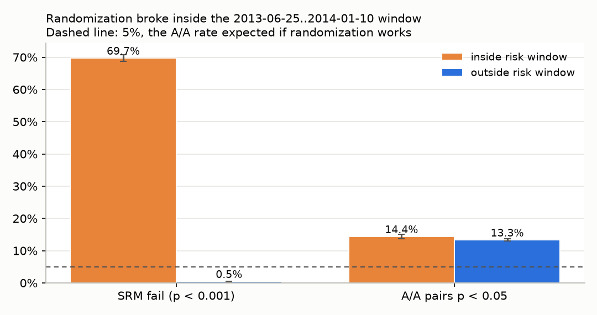
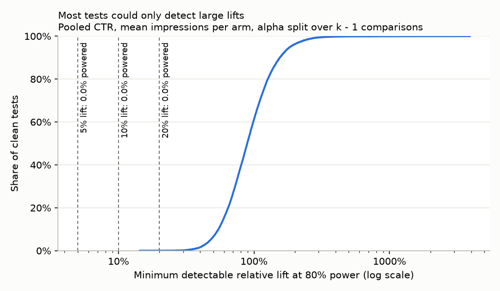
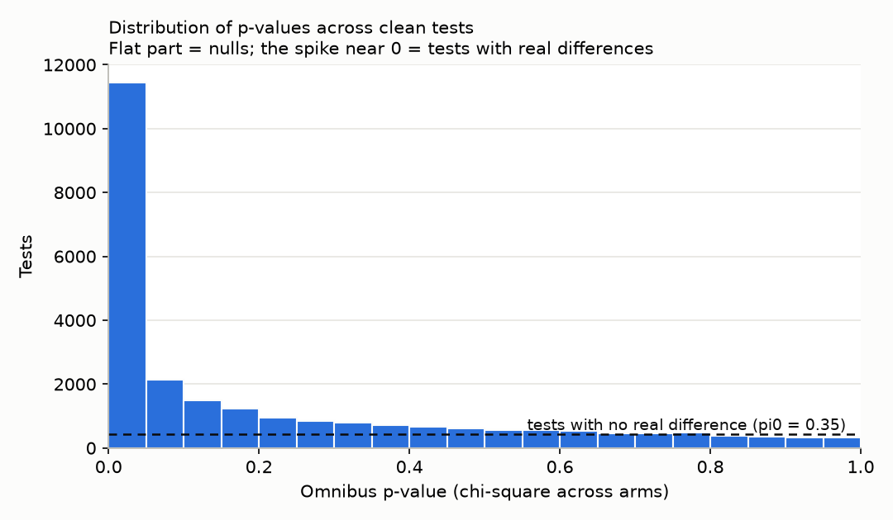
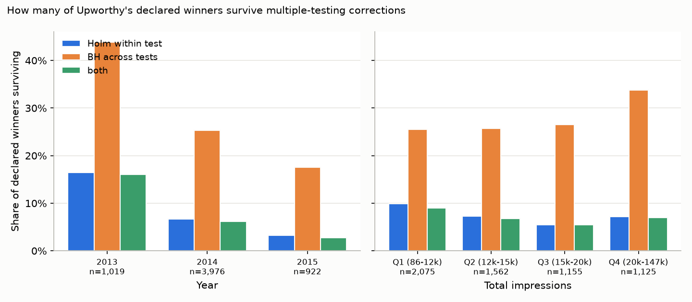

# How many of Upworthy's A/B test results hold up?

<!-- Generated by analysis/portfolio_findings.py from analysis/output/portfolio_*.csv. Do not edit by hand; run `make portfolio findings`. -->

A portfolio view of the Upworthy Research Archive: every test run through the `abtest` library by `analysis/portfolio.py`. Tests inside the 2013-06-25..2014-01-10 randomization-risk window or failing SRM are flagged (7,138 of 32,487) and left out of everything after section 1, leaving **25,349 clean tests**.

## Headline numbers

1. **Randomization broke inside the risk window.** SRM fails in 69.7% (4,893 of 7,017) of tests inside it vs 0.5% (119 of 25,468) outside. A/A pairs reach p < 0.05 in 14.4% of cases inside and 13.3% outside, against 5% expected.
2. **Almost no test was powered for a realistic lift.** None of the 25,347 clean tests could detect a 10% lift at 80% power; the median minimum detectable lift is 89%.
3. **Storey's pi0 = 0.35**: taken at face value, about 65% of clean tests have some real difference between arms (but see the A/A caveat below).
4. **11,432 of 25,349 clean tests are significant at p < 0.05 raw; 8,984 after Benjamini-Hochberg at 5%.**
5. **Only 7.3% of 5,917 declared winners survive both Holm within their test and BH across tests** (7.8% survive Holm, 27.3% survive BH).

## 1. Data health

**SRM.** 15.4% (5,012 of 32,485) of tests fail a chi-square test of an equal split at p < 0.001. Inside the risk window it is 69.7% (4,893 of 7,017; 95% CI 68.6% to 70.8%); outside, 0.5% (119 of 25,468; 95% CI 0.4% to 0.6%), against 0.1% expected by chance. The window is where traffic allocation broke, and outside it SRM is rare.

**A/A pairs.** Arms with the same headline and image should differ at p < 0.05 about 5% of the time. Across 42,924 pairs outside the window the rate is 13.3% (5,720 of 42,924; 95% CI 13.0% to 13.7%); inside it is 14.4%. Taking one pair per test, so no arm counts twice, gives 11.8% outside; pairs that also share excerpt and lede give 14.8%. Restricted to clean tests the rate is still 13.3%, 2.7 times the nominal 5%.

Unlike SRM, the A/A excess is not confined to the risk window, so dropping flagged tests does not remove it. Either the "identical" arms differed in something the archive does not record, or click counts vary more than a binomial model allows (for example traffic that changes over the life of a test). Either way, a pooled z-test or chi-square p-value on this data is too small for a true null, and that matters for sections 3 and 4.

## 2. Power

For each clean test, the smallest relative lift detectable at 80% power, at the test's pooled click rate and mean impressions per arm, with alpha split over the k - 1 comparisons:

| target lift | tests powered | share |
|---:|---:|---:|
| 5% | 0 of 25,347 | 0.0% |
| 10% | 0 of 25,347 | 0.0% |
| 20% | 2 of 25,347 | 0.0% |

The median MDE is 89% (middle half 69% to 118%). Even without splitting alpha across arms, 0.03% of tests are powered for a 20% lift and the median MDE is 74%. A typical test could reliably detect only a lift of about 89%. When a test this small does reach significance, the estimated lift is usually inflated (the winner's curse; `analysis/shrinkage.py` measures how much).

## 3. Portfolio inference

One chi-square omnibus p-value per clean test. 11,432 fall below 0.05, against an average of 445 per 0.05-wide bin above 0.5. Storey's estimate of the share of tests with no real difference is pi0 = 0.35 at lambda = 0.5, ranging from 0.45 (lambda = 0.2) to 0.28 (lambda = 0.8).

At face value: 11,432 tests (45.1%) are significant raw and 8,984 (35.4%) after BH at 5%, and with pi0 = 0.35 BH's actual FDR bound is 1.8%.

**Caveat.** pi0 and BH both assume a null p-value is uniform. The A/A pairs show it is not here: identical arms reach p < 0.05 2.7 times as often as they should. Null tests therefore pile up near 0 too, which pushes pi0 down and the BH count up. Read 0.35 as a lower bound on the share of null tests and 8,984 as an upper bound on the discoveries.

## 4. Upworthy's declared winners

5,917 clean tests have a declared winner. Inside a test there is no control arm, so the winner is compared with every other arm and survives Holm only if it has the higher click rate in all comparisons and all are rejected. 7.8% survive. In 1,643 tests (27.8%) the declared winner does not even have the highest observed click rate. Across tests, 27.3% of winners sit in a test whose omnibus p-value survives BH, and 7.3% pass both.

Holm within the test is the binding filter: 434 of the 462 winners that survive Holm also survive BH. The same A/A caveat applies, since Holm uses the same kind of p-values, so 7.3% is an upper bound on the share of winners that would hold up.

**By year.** Survival of both corrections falls from 16.0% in 2013 to 2.7% in 2015, while the share of tests with a declared winner goes from 45.5% to 20.9%. Clean 2013 tests all start before the risk window opens on 2013-06-25.

| year | clean tests | declared winners | survive Holm | survive BH | survive both |
|---|---:|---:|---:|---:|---:|
| 2013 | 2,238 | 1,019 | 16.5% | 43.9% | 16.0% |
| 2014 | 18,703 | 3,976 | 6.6% | 25.4% | 6.2% |
| 2015 | 4,408 | 922 | 3.3% | 17.6% | 2.7% |

**By test size** (quartiles of total impressions). Survival of both is 9.0% in the smallest quartile and 6.9% in the largest. Size is total traffic, not traffic per arm.

| total impressions | clean tests | declared winners | survive Holm | survive BH | survive both |
|---|---:|---:|---:|---:|---:|
| Q1 (86-12k) | 6,338 | 2,075 | 9.9% | 25.5% | 9.0% |
| Q2 (12k-15k) | 6,337 | 1,562 | 7.2% | 25.7% | 6.8% |
| Q3 (15k-20k) | 6,337 | 1,155 | 5.5% | 26.5% | 5.5% |
| Q4 (20k-147k) | 6,337 | 1,125 | 7.2% | 33.8% | 6.9% |

**By number of arms.** Survival of both is 10.6% with 2 arms and 3.4% with 6+: each added arm is one more rival the winner must beat, and each comparison gets less traffic.

| arms | clean tests | declared winners | survive Holm | survive BH | survive both |
|---|---:|---:|---:|---:|---:|
| 2 | 655 | 303 | 16.2% | 11.2% | 10.6% |
| 3 | 886 | 393 | 10.9% | 20.4% | 10.4% |
| 4 | 11,057 | 3,146 | 8.6% | 28.7% | 8.4% |
| 5 | 5,605 | 1,103 | 5.9% | 28.3% | 5.8% |
| 6+ | 7,146 | 972 | 3.4% | 29.6% | 3.4% |

## Method notes

- Statistics come from `abtest`: `srm.srm_check`, `proportions.chi2_omnibus` and `two_proportion_ztest`, `power.mde_for_n`, `multiple.within_test`, `adjust` and `storey_pi0`. Winner counts are checked against `multiple.winner_survival`.
- Flagged = inside the randomization-risk window (dates only; the June 2024 risk column is not in the OSF files) or SRM p < 0.001 against an equal split.
- MDE uses the test's pooled CTR as baseline, mean impressions per arm, 80% power and alpha = 0.05 / (k - 1).
- When a test declares more than one winner, the lowest-numbered arm is used.
- A/A pairs are arms in the same test with the same headline and eyecatcher id (`marts.fct_aa_pairs`); a group of k identical arms gives k(k - 1)/2 pairs.
