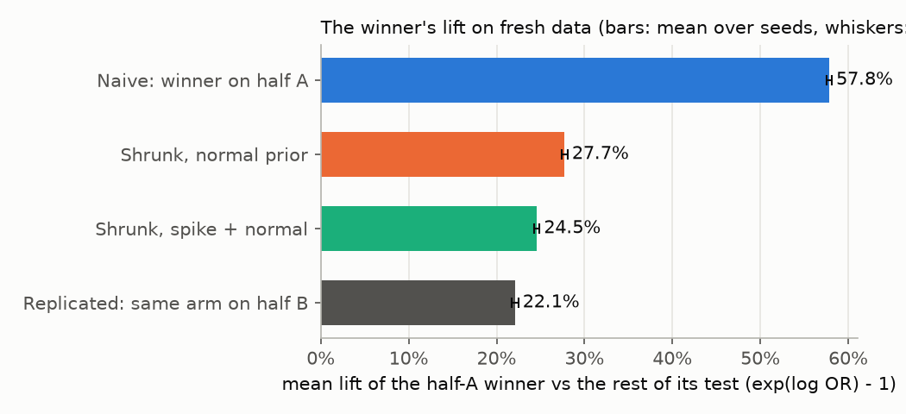
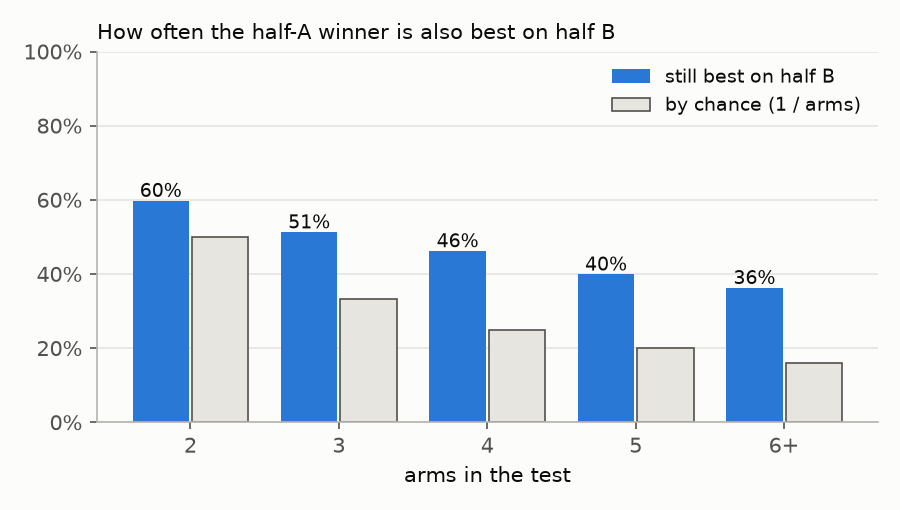
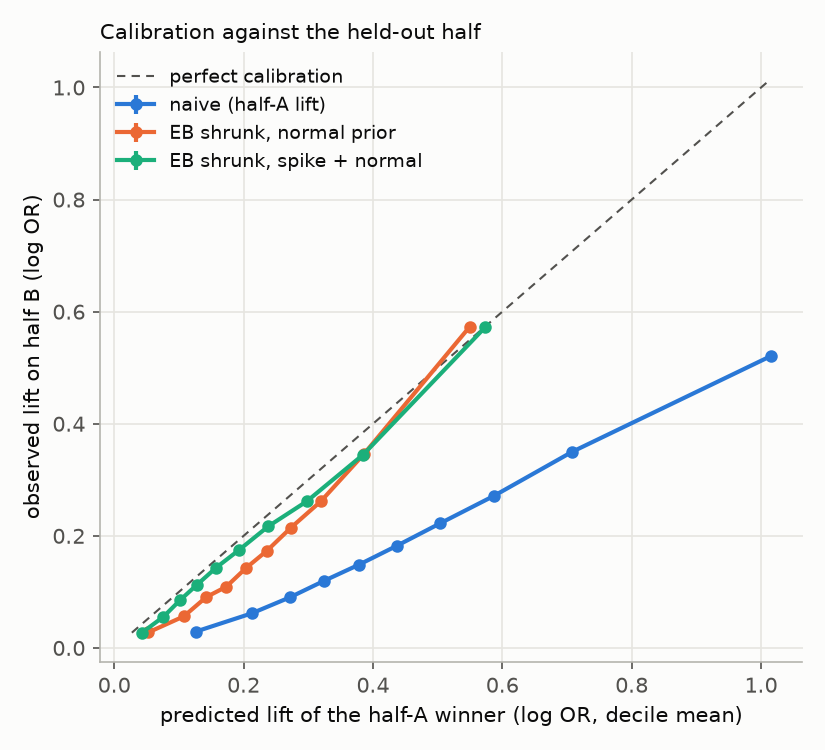
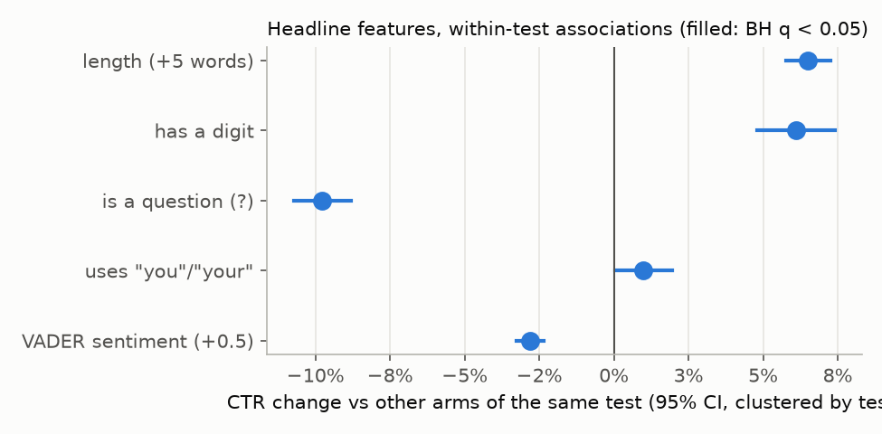

# The winner's curse, measured by data thinning

_Generated by `analysis/winners_curse_findings.py` from `analysis/output/winners_curse_*.csv` (`make winners-curse`, then `make winners-curse-doc`). Do not edit by hand._

## Headline numbers

1. **The half-A winner's lift is overstated by 129%.** Measured on the half it was picked on, the winner beats the rest of its test by 57.8%; on the other half, the same arm beats it by 22.1%, so 44% of the naive lift replicates (mean over 20 splits of 25,349 clean tests).
2. **The half-A winner is still the best arm on half B in 42.5% of tests**, against 22.3% expected if every arm were equally good.
3. **Shrinkage fixes most of it.** The shrunk estimate with the spike + normal prior predicts the held-out lift with 65% less error than the naive lift (MSE against the true lift, estimated by removing half B's own noise), and its calibration slope is 1.02 against 0.56 for the naive lift (1 is perfectly calibrated).
4. **The prior holds out of sample.** Fitted on the exploratory tests only, the shrunk estimate with the spike + normal prior predicts the confirmatory tests' held-out lifts about as well as a prior fitted on the confirmatory tests themselves (MSE 0.045 vs 0.044; naive 0.128).
5. **5 of 5 headline features are associated with CTR within tests after BH correction:** length (+5 words) 6.5%, has a digit 6.1%, is a question (?) -9.8%, uses "you"/"your" 1.0%, VADER sentiment (+0.5) -2.8% (CTR vs other arms of the same test, holding the other features fixed). These are associations, not rules.

## Method

Every arm's impressions are split 50/50 at random and its clicks drawn hypergeometrically (`abtest.thinning.split_binomial`), which turns each test into two independent half-tests with the same true click rates, provided clicks are binomial. The arm with the highest CTR on half A is the winner; its log odds ratio against the pooled rest of its test on half A is the naive lift, and the same contrast on half B is an honest replication, because half B played no part in picking it. This is repeated with 20 fixed seeds and averaged.

Sample: 25,349 clean tests of 32,487, dropping 7,019 in the 2013-06-25 to 2014-01-10 randomization-risk window, 119 failing SRM (p < 0.001), 0 with one arm and 0 with an arm without impressions (the same rule as `analysis/portfolio.py`).

Lifts are relative lifts `exp(mean log OR) - 1` of the winner against the rest of its test. Each half has half the data, so a half-test is noisier than the full test and its winner's curse is bigger than the full test's; the comparison between methods is fair because every method sees only half A.

## 1. Naive vs replicated lift

| | mean relative lift | range over seeds |
|---|---:|---:|
| Naive: winner on half A | 57.8% | 57.5% to 58.1% |
| Replicated: same arm on half B | 22.1% | 21.7% to 22.5% |
| EB shrunk, normal prior (half A only) | 27.7% | |
| EB shrunk, spike + normal (half A only) | 24.5% | |

Kept: 44% of the naive log-odds lift replicates (range 43% to 44%); the naive lift overstates the replicated one by 129%.

### Does the winner stay the winner?

| arms | tests | naive lift | replicated lift | kept | still best on half B | by chance |
|---|---:|---:|---:|---:|---:|---:|
| 2 | 655 | 40.7% | 13.1% | 36% | 59.8% | 50.0% |
| 3 | 886 | 46.8% | 17.1% | 41% | 51.3% | 33.3% |
| 4 | 11,057 | 55.6% | 22.3% | 46% | 46.2% | 25.0% |
| 5 | 5,605 | 59.4% | 21.3% | 41% | 39.9% | 20.0% |
| 6+ | 7,146 | 63.2% | 23.8% | 44% | 36.3% | 15.9% |
| all | 25,349 | 57.8% | 22.1% | 44% | 42.5% | 22.3% |

## 2. Do shrunk estimates predict the held-out half?

On every split an empirical Bayes prior (`abtest.bayes`, from PR #8) is fitted on every arm's half-A contrast, before any picking, and used to shrink the winner's half-A lift. Each prediction is scored against the winner's half-B lift.

| method | mean prediction | bias vs half B | MSE vs half B | MSE vs true lift | calibration slope |
|---|---:|---:|---:|---:|---:|
| Naive (half-A lift) | 0.456 | 0.257 | 0.222 | 0.129 | 0.56 |
| EB shrunk, normal prior | 0.244 | 0.045 | 0.140 | 0.047 | 1.12 |
| EB shrunk, spike + normal prior | 0.219 | 0.020 | 0.138 | 0.045 | 1.02 |

Log-odds scale, mean over seeds (slope: median). Half B is noisy, but its noise is independent of anything computed on half A, so it adds the same 0.093 (mean squared standard error of the half-B lift) to every method's MSE; subtracting it estimates the error against the true lift. Bias is the mean prediction minus the mean half-B lift. The calibration slope regresses half B on the prediction: below 1 means the predictions are too spread out (overconfident), which is what the winner's curse looks like.

Fitted priors on half A (mean over seeds): normal tau 0.307; spike + normal pi0 0.40, tau 0.316.

## 3. Out-of-sample prior: exploratory to confirmatory

The archive comes in three random parts (exploratory, confirmatory, holdout). The prior is fitted on every arm of the clean exploratory tests (full data) and checked on the other parts two ways: the share of their arm contrasts inside the prior's 95% predictive interval (should be about 95%) with the mean log predictive density, and the thinning score of section 2 with the exploratory prior in place of the in-sample half-A prior.

| target | prior | fitted on | contrasts | 95% coverage | mean log score | pi0 | tau |
|---|---|---|---:|---:|---:|---:|---:|
| confirmatory | normal | exploratory | 85,286 | 95.1% | -0.366 | 0.00 | 0.293 |
| confirmatory | normal | confirmatory (in-sample) | 85,286 | 95.5% | -0.370 | 0.00 | 0.304 |
| confirmatory | spike_slab | exploratory | 85,286 | 94.4% | -0.346 | 0.35 | 0.320 |
| confirmatory | spike_slab | confirmatory (in-sample) | 85,286 | 94.7% | -0.346 | 0.33 | 0.325 |
| holdout | normal | exploratory | 18,255 | 94.8% | -0.377 | 0.00 | 0.293 |
| holdout | normal | holdout (in-sample) | 18,255 | 95.3% | -0.381 | 0.00 | 0.306 |
| holdout | spike_slab | exploratory | 18,255 | 94.2% | -0.358 | 0.35 | 0.320 |
| holdout | spike_slab | holdout (in-sample) | 18,255 | 94.6% | -0.358 | 0.33 | 0.327 |

| target | method | prior fitted on | tests | bias vs half B | MSE vs true lift | calibration slope |
|---|---|---|---:|---:|---:|---:|
| confirmatory | Naive (half-A lift) | none | 17,741 | 0.255 | 0.128 | 0.56 |
| confirmatory | EB shrunk, normal prior | confirmatory half A (in-sample) | 17,741 | 0.045 | 0.047 | 1.12 |
| confirmatory | EB shrunk, spike + normal prior | confirmatory half A (in-sample) | 17,741 | 0.019 | 0.044 | 1.02 |
| confirmatory | EB shrunk, normal prior | exploratory | 17,741 | 0.040 | 0.047 | 1.16 |
| confirmatory | EB shrunk, spike + normal prior | exploratory | 17,741 | 0.021 | 0.045 | 1.02 |
| holdout | Naive (half-A lift) | none | 3,803 | 0.262 | 0.134 | 0.55 |
| holdout | EB shrunk, normal prior | holdout half A (in-sample) | 3,803 | 0.048 | 0.049 | 1.11 |
| holdout | EB shrunk, spike + normal prior | holdout half A (in-sample) | 3,803 | 0.024 | 0.046 | 1.02 |
| holdout | EB shrunk, normal prior | exploratory | 3,803 | 0.042 | 0.049 | 1.16 |
| holdout | EB shrunk, spike + normal prior | exploratory | 3,803 | 0.023 | 0.046 | 1.03 |

The in-sample rows fit the prior on the same tests they score, which flatters them; a prior that transfers should come close to them.

## 4. Headline features (descriptive)

Each arm's empirical-logit CTR is regressed on features of its headline, demeaned within test (test fixed effects), so an arm is only ever compared with other arms of the same test, which saw the same audience at the same time. Standard errors are clustered by test, and the five p-values are BH-corrected. Sentiment is VADER's compound score (a free lexicon tuned to social media text), in steps of 0.5 on its -1 to 1 scale.

121,845 arms in 25,349 clean tests.

| feature | share / mean | tests where it varies | CTR change (joint) | 95% CI | BH q | CTR change (alone) | BH q (alone) |
|---|---:|---:|---:|---:|---:|---:|---:|
| length (+5 words) | 15.18 words | 13,545 | 6.5% | 5.8% to 7.2% | 0.000 | 6.8% | 0.000 |
| has a digit | 19.2% | 4,738 | 6.1% | 4.8% to 7.4% | 0.000 | 7.2% | 0.000 |
| is a question (?) | 14.8% | 6,067 | -9.8% | -10.7% to -8.8% | 0.000 | -9.9% | 0.000 |
| uses "you"/"your" | 24.3% | 7,223 | 1.0% | 0.0% to 2.0% | 0.043 | 0.6% | 0.219 |
| VADER sentiment (+0.5) | 0.04 | 13,097 | -2.8% | -3.3% to -2.3% | 0.000 | -2.7% | 0.000 |

How to read this. Randomization inside a test makes each within-test contrast causal for that pair of packages: the difference in CTR between two arms of one test was caused by showing one package instead of the other. It does not make a feature causal. Two headlines that differ in length also differ in wording, topic emphasis and, often, image, and editors chose which variants to write; the coefficients are average associations across those pairs, not rules for writing headlines.

## Caveats

- **Overdispersion makes this a lower bound.** Thinning gives independent halves only if clicks are binomial. The archive's natural A/A pairs are significant at p < 0.05 about 13% of the time instead of 5% (`docs/portfolio_findings.md`), so arms carry extra-binomial shocks (time of day, placement, a share that took off) that land in both halves. Picking on half A also picks on those shocks, and half B inherits them, so the replicated lift still contains some luck: the true overstatement is at least as large as measured here.
- **Half-tests are noisier than full tests**, so the size of the curse here is for a test half as large as the one Upworthy ran. The shrinkage results carry over because the prior is over true lifts, which do not depend on sample size.
- **Lift is against the pooled rest of the test**, as in `abtest.bayes`, not against a control arm, since the archive has no control.
- Feature associations are averaged over tests where the feature varies; tests that only changed the image add nothing to them.

Seeds: 0, 1, 2, 3, 4, 5, 6, 7, 8, 9, 10, 11, 12, 13, 14, 15, 16, 17, 18, 19.
