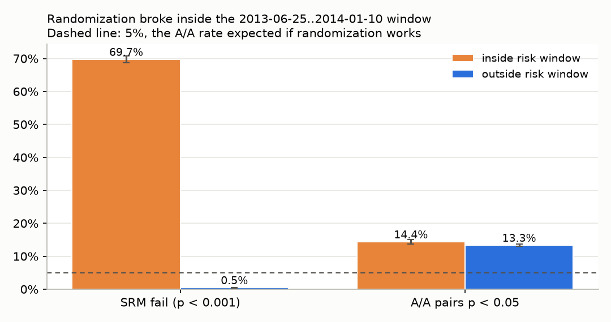
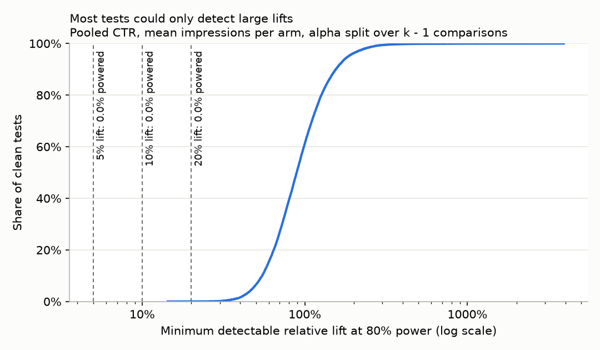
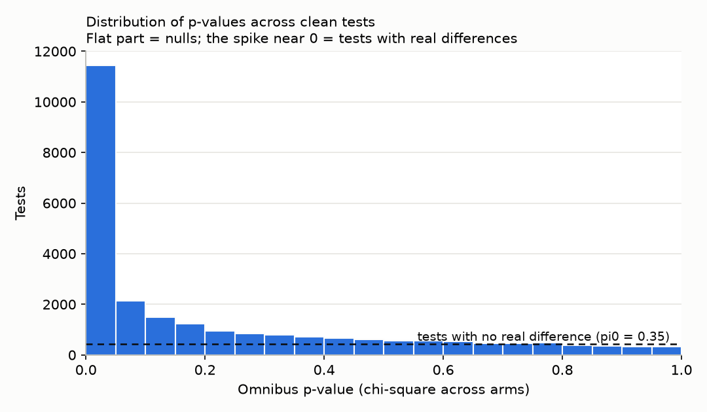
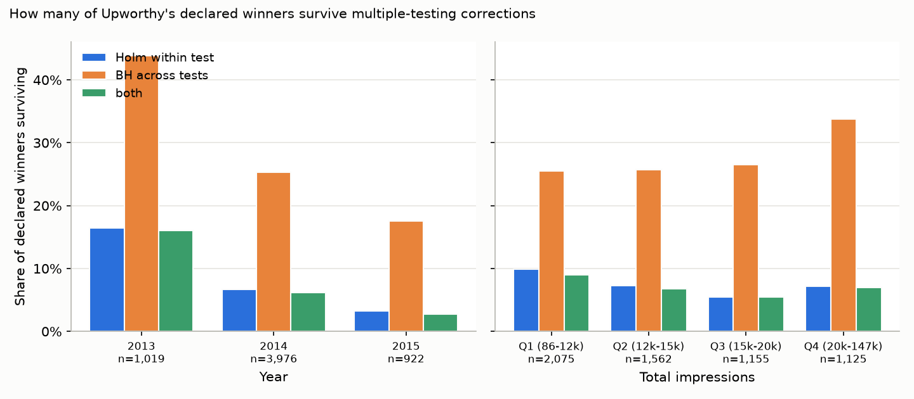
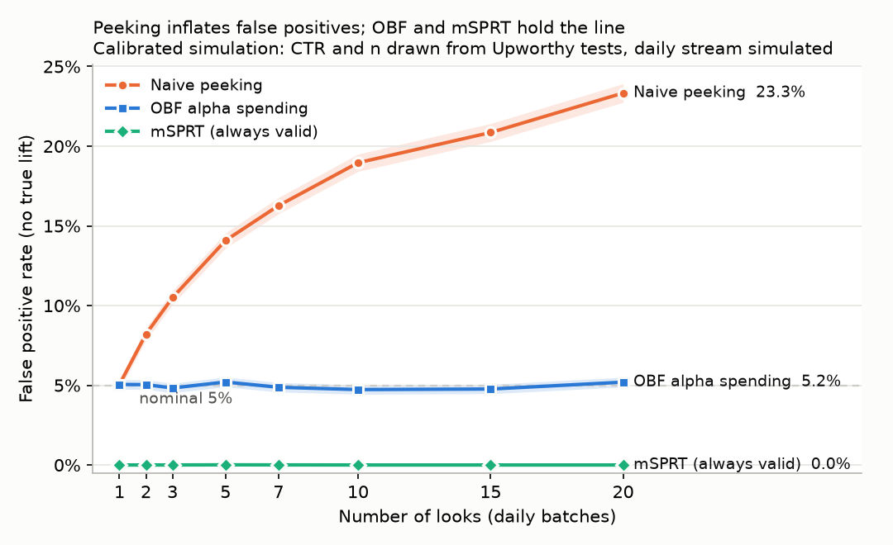
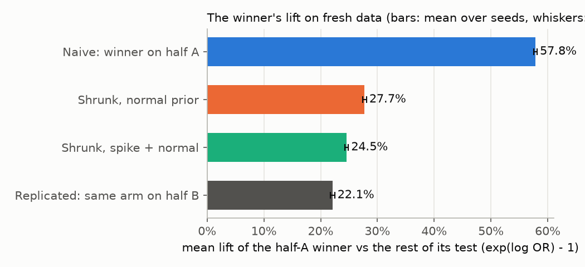
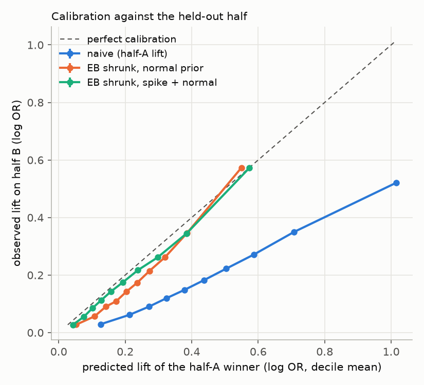
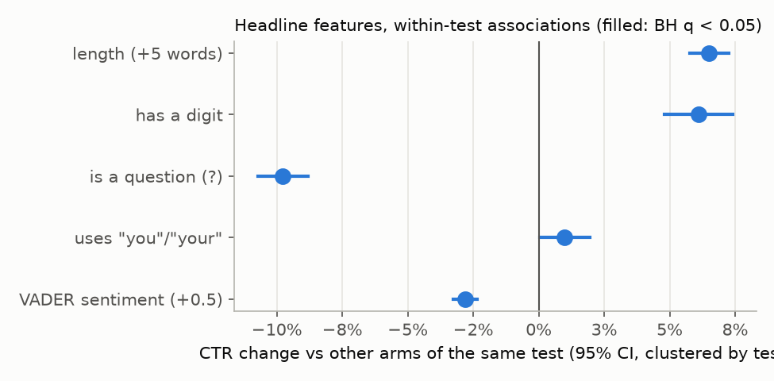

```{python}
#| label: setup
from pathlib import Path

import pandas as pd
from IPython.display import Markdown

from abtest.power import sample_size_per_arm

OUT = Path("../analysis/output")
FIX = Path("../tests/fixtures/packages_sample.csv")


def read(name: str) -> pd.DataFrame:
    return pd.read_csv(OUT / f"{name}.csv")


def pct(x: float, d: int = 1) -> str:
    return f"{100 * x:.{d}f}%"


def num(x: float) -> str:
    return f"{int(round(x)):,}"


def table(df: pd.DataFrame) -> Markdown:
    return Markdown(df.to_markdown(index=False))


health = read("portfolio_health").set_index(["metric", "window"])
power = read("portfolio_power").set_index(["correction", "target_lift"])
inf = read("portfolio_inference")
inf = inf[inf["sample"] == "clean"].set_index("metric")["value"]
pv = read("portfolio_pvalues")
win = read("portfolio_winners")
peek = read("peeking")
shr = read("shrinkage_summary").set_index("fit")
wc = read("winners_curse_headline").set_index("metric")["mean"]
by_arms = read("winners_curse_by_arms")
oos = read("winners_curse_oos")
feat = read("winners_curse_features")

H = lambda m, w: health.loc[(m, w)]  # noqa: E731
srm_in, srm_out, srm_all = H("srm_fail", "inside"), H("srm_fail", "outside"), H("srm_fail", "all")
flag_all = H("flagged", "all")
aa_out, aa_in = H("aa_p05_all_pairs", "outside"), H("aa_p05_all_pairs", "inside")
aa_clean = H("aa_p05_all_pairs_clean_tests", "outside")
aa_ratio = aa_clean["share"] / 0.05

n_tests = int(flag_all["n"])
n_clean = int(inf["n_tests"])
pw10 = power.loc[("bonferroni_k_minus_1", 0.1)]
pw20 = power.loc[("bonferroni_k_minus_1", 0.2)]
mde_med = pw10["mde_median"]

w_all = win[win["dimension"] == "all"].iloc[0]


def peek_rate(rule: str, looks: int, lift: float = 0.0, col: str = "rejection_rate") -> float:
    s = peek[(peek.scenario == "sweep") & (peek.rule == rule) & (peek.n_looks == looks)]
    return float(s[s.lift == lift][col].iloc[0])


emp = peek[peek.scenario == "empirical"]
emp_naive_null = float(emp[(emp.rule == "naive") & (emp.lift == 0)]["rejection_rate"].iloc[0])

spike = shr.loc["spike + normal, fit on all arms"]
normal = shr.loc["normal prior, fit on all arms"]
wrong = shr.loc["normal prior, fit on winners (wrong)"]
mse_cut = 1 - wc["mse_true_spike_slab"] / wc["mse_true_naive"]

oos_t = oos[(oos.check == "thinning") & (oos.target == "confirmatory")].set_index(
    ["prior", "fitted_on"]
)
oos_explo = oos_t.loc[("spike_slab", "exploratory")]
oos_in = oos_t.loc[("spike_slab", "confirmatory half A (in-sample)")]
oos_naive = oos_t.loc[("naive", "none")]

fj = feat[feat.model == "joint"].set_index("feature")

fix = pd.read_csv(FIX)
fix_ctr = float((fix.clicks / fix.impressions).median())
fix_n = float(fix.groupby("clickability_test_id").impressions.mean().median())
need10 = sample_size_per_arm(fix_ctr, 0.10).n_per_arm
need20 = sample_size_per_arm(fix_ctr, 0.20).n_per_arm
```

::: {.callout-note appearance="simple"}
## Three findings

1. **Only `{python} pct(w_all["share_survive_both"])` of Upworthy's `{python} num(w_all["n_with_winner"])` declared winners survive multiple-testing correction** (Holm inside the test and Benjamini-Hochberg across tests).
2. **Picked winners overstate their lift by `{python} pct(wc["overstatement"], 0)`.** The best arm on one random half of the traffic beats the rest by `{python} pct(wc["naive_rel"])`; on the other half the same arm beats it by `{python} pct(wc["replicated_rel"])`.
3. **No clean test was powered for a 10% lift.** The median test could reliably detect only a lift of `{python} pct(mde_med, 0)`; empirical Bayes shrinkage cuts the error of the reported lift by `{python} pct(mse_cut, 0)`.
:::

Every number in this report is read at render time from the CSVs in `analysis/output/`, which the pipeline writes from the real archive (`make all`). Nothing is typed in by hand.

# The question

A product team that runs thousands of A/B tests ships whichever variant "won". Two questions decide whether that is a good habit:

- **How many of those winners are real?** With thousands of tests at p < 0.05, some winners are flukes. How many?
- **How big are the real ones?** The variant that looked best was picked *because* it looked best, so its measured lift includes the luck that got it picked (the *winner's curse*). How much should the reported lift be discounted?

Upworthy is a rare chance to answer both on real data: it tested almost every headline it published, and the full record of `{python} num(n_tests)` tests is public.

# The data and its known problems

[The Upworthy Research Archive](https://upworthy.natematias.com/) (Matias et al., 2021, *Scientific Data*) holds every headline test Upworthy ran from January 2013 to April 2015. Each test showed several *packages* (a headline, an image and a short excerpt) to random visitors and recorded impressions and clicks per package. It is released in three random parts: exploratory, confirmatory and holdout. This project uses all three, and keeps the exploratory/confirmatory split for one out-of-sample check.

Known problems, and what this project does about each:

| problem | consequence | what is done |
|---|---|---|
| Upworthy's randomization was faulty between 2013-06-25 and 2014-01-10 (documented by the archive authors) | traffic split between arms is not random in that window | every test in the window is flagged and excluded after the data-health section |
| The archive's newer per-test risk column (2024) is not in the OSF files | the window has to be set by date | date window only |
| Some tests outside the window also have a broken split | biased comparisons | sample ratio mismatch (SRM) check on every test; failures excluded |
| Arms with identical headline and image differ more than chance allows | p-values are too small even on clean tests | measured with natural A/A pairs and carried as a caveat into every result |
| No control arm, only final counts, no test end dates | lifts are against the rest of the test; peeking has to be simulated | stated in each section |

After dropping flagged tests, **`{python} num(n_clean)` clean tests** remain.

# Methods in plain English

- **Pipeline.** A Python script downloads the archive from OSF and loads it into DuckDB. dbt cleans it (types, duplicates, identical-arm pairs, one row per test) and checks it with data tests. All statistics come from a small tested Python library, `abtest`, and scripts in `analysis/` write the CSVs and figures this report reads.
- **Sample ratio mismatch (SRM).** If traffic is meant to be split evenly, a chi-square test asks whether the observed split is plausible. A failure (p < 0.001) means assignment or logging broke, so the test cannot be trusted.
- **A/A pairs.** Some tests contain two identical packages. Their click rates should differ at p < 0.05 only 5% of the time. More than that means the p-values are too optimistic.
- **Power.** For each test, the smallest lift it could detect 80% of the time, given its traffic and click rate.
- **Multiple testing.** Within a test, the declared winner has to beat every other arm with a Holm correction. Across tests, Benjamini-Hochberg (BH) controls the false discovery rate: the share of "wins" that are flukes.
- **Peeking.** The archive has no daily counts, so peeking is simulated: test sizes and click rates are drawn from the real tests, traffic arrives in daily batches with no true difference, and each stopping rule is scored.
- **Data thinning.** Each arm's traffic is split at random into two halves. The winner is picked on half A and measured on half B, which played no part in picking it. The gap between the two is the winner's curse. Repeated with 20 seeds.
- **Empirical Bayes shrinkage.** Fit the distribution of true lifts across all arms of all tests, then pull each winner's lift toward it in proportion to how noisy it is. The *spike + normal* prior allows a share of arms to have no effect at all.

# Results

## Data health

{width=85%}

SRM fails in **`{python} pct(srm_in["share"])`** of tests inside the risk window (`{python} num(srm_in["k"])` of `{python} num(srm_in["n"])`) and in **`{python} pct(srm_out["share"])`** outside it (`{python} num(srm_out["k"])` of `{python} num(srm_out["n"])`), against 0.1% expected by chance. The archive's warning is confirmed, and outside the window the split is healthy.

The A/A pairs are the surprise. Identical arms reach p < 0.05 in **`{python} pct(aa_out["share"])`** of `{python} num(aa_out["n"])` pairs outside the window (`{python} pct(aa_in["share"])` inside), against 5% expected. Restricted to clean tests it is still `{python} pct(aa_clean["share"])`, **`{python} f"{aa_ratio:.1f}"` times the nominal rate**. Clicks vary more than a binomial model allows, so every p-value below is somewhat too small. That makes the counts of "real" winners below upper bounds.

## Power

{width=85%}

```{python}
#| label: tbl-power
#| tbl-cap: "Clean tests powered (80%) to detect each lift, alpha split over the k - 1 comparisons"
p = power.loc["bonferroni_k_minus_1"].reset_index()
table(
    pd.DataFrame(
        {
            "target lift": [pct(x, 0) for x in p["target_lift"]],
            "tests powered": [f"{num(a)} of {num(b)}" for a, b in zip(p.n_powered, p.n_tests)],
            "share": [pct(x, 2) for x in p["share_powered"]],
        }
    )
)
```

The median clean test could detect only a lift of **`{python} pct(mde_med, 0)`** (middle half `{python} pct(pw10["mde_p25"], 0)` to `{python} pct(pw10["mde_p75"], 0)`). Headline changes rarely move click rates that much, so most tests could not see the effects they were looking for. When an underpowered test does reach significance, its estimate is inflated: the winner's curse below.

## How many winners are real?

{width=85%}

`{python} num(inf["n_raw_significant"])` clean tests (`{python} pct(inf["share_raw_significant"])`) have an omnibus p < 0.05, and `{python} num(inf["n_bh_significant"])` survive BH at 5%. Storey's estimate of the share of tests with no real difference is π₀ = `{python} f"{inf['pi0']:.2f}"`. Given the A/A excess, null p-values also pile up near zero, so read π₀ as a lower bound and the BH count as an upper bound.

{width=85%}

Upworthy declared a winner in `{python} num(w_all["n_with_winner"])` clean tests. **`{python} pct(w_all["share_survive_within"])` survive Holm within their test, `{python} pct(w_all["share_survive_portfolio"])` sit in a test that survives BH, and `{python} pct(w_all["share_survive_both"])` pass both.** In `{python} num(w_all["n_winner_not_top_ctr"])` tests the declared winner did not even have the highest observed click rate.

```{python}
#| label: tbl-winners
#| tbl-cap: "Declared winners surviving both corrections"
w = win[win.dimension.isin(["year", "arms"])]
table(
    pd.DataFrame(
        {
            "group": w.dimension + " " + w.level.astype(str),
            "clean tests": w.n_tests.map(num),
            "declared winners": w.n_with_winner.map(num),
            "survive Holm": w.share_survive_within.map(pct),
            "survive BH": w.share_survive_portfolio.map(pct),
            "survive both": w.share_survive_both.map(pct),
        }
    )
)
```

Survival falls with every added arm, because each arm is one more rival the winner must beat with less traffic per comparison.

## Peeking

{width=85%}

```{python}
#| label: tbl-peeking
#| tbl-cap: "Simulated tests with no true difference: share declared significant"
looks = [1, 2, 5, 10, 20]
table(
    pd.DataFrame(
        {
            "looks": looks,
            "naive (stop at first p < 0.05)": [pct(peek_rate("naive", k)) for k in looks],
            "O'Brien-Fleming": [pct(peek_rate("obf", k)) for k in looks],
            "mSPRT (always valid)": [pct(peek_rate("msprt", k), 2) for k in looks],
        }
    )
)
```

Checking a test every day and stopping at the first p < 0.05 turns a 5% false positive rate into **`{python} pct(peek_rate("naive", 10))` at 10 looks** and `{python} pct(peek_rate("naive", 20))` at 20. An O'Brien-Fleming alpha-spending rule keeps it at `{python} pct(peek_rate("obf", 10))` and, for a 50% lift, still has `{python} pct(peek_rate("obf", 10, 0.5))` power (fixed test: `{python} pct(peek_rate("fixed", 10, 0.5))`) while saving `{python} pct(peek_rate("obf", 10, 0.5, "sample_saved"))` of traffic on average. mSPRT is valid at any number of looks but at Upworthy's sample sizes it almost never rejects (`{python} pct(peek_rate("msprt", 10, 0.5))` power for a 50% lift).

Upworthy's tests mostly ran within one calendar day (inferred from package creation times; the archive has no end dates), and simulated with their own look counts the naive rate is `{python} pct(emp_naive_null)`. Peeking was probably not Upworthy's main problem. It is the main problem for a team that watches a dashboard for two weeks.

## The winner's curse

{width=85%}

On `{python} num(wc["n_tests"])` clean tests and `{python} num(wc["n_seeds"])` random splits, the arm that looks best on half A beats the rest of its test by **`{python} pct(wc["naive_rel"])`**. On half B the same arm beats it by **`{python} pct(wc["replicated_rel"])`**. Only `{python} pct(wc["kept"], 0)` of the naive lift replicates. The half-A winner is still the best arm on half B in `{python} pct(wc["still_best"])` of tests, against `{python} pct(wc["still_best_chance"])` if all arms were equal: winners are better than average, just much less than they look.

```{python}
#| label: tbl-arms
#| tbl-cap: "Winner's curse by number of arms (half A picks, half B measures)"
table(
    pd.DataFrame(
        {
            "arms": by_arms.n_arms.astype(str),
            "tests": by_arms.n_tests.map(num),
            "naive lift": by_arms.naive_rel.map(pct),
            "replicated lift": by_arms.replicated_rel.map(pct),
            "still best": by_arms.still_best.map(pct),
            "by chance": by_arms.still_best_chance.map(pct),
        }
    )
)
```

**Shrinkage fixes most of it.** An empirical Bayes prior fitted on half A only (spike + normal) shrinks the winner's lift to `{python} pct(wc["mean_spike_slab_rel"])`, close to the replicated `{python} pct(wc["replicated_rel"])`. Against the held-out half its error is **`{python} pct(mse_cut, 0)` lower** than the naive lift's, and its calibration slope is `{python} f"{wc['slope_spike_slab']:.2f}"` against `{python} f"{wc['slope_naive']:.2f}"` for the naive lift (1 is perfect).

{width=85%}

Two checks that the shrinkage is not overfit:

- **Out of sample.** A prior fitted only on the exploratory tests predicts the confirmatory tests' held-out lifts with error `{python} f"{oos_explo['mse_true']:.3f}"`, against `{python} f"{oos_in['mse_true']:.3f}"` for a prior fitted on the confirmatory tests themselves and `{python} f"{oos_naive['mse_true']:.3f}"` for the naive lift.
- **Fit on all arms, not winners.** On the full data the spike + normal prior keeps `{python} pct(spike["retained"], 0)` of the naive log-odds lift. Fitting the prior on winners only keeps `{python} pct(wrong["retained"], 0)`: the prior absorbs the curse it is meant to correct.

## Headline features

{width=85%}

```{python}
#| label: tbl-features
#| tbl-cap: "Change in click rate vs other arms of the same test (joint model, BH-corrected)"
fj2 = fj.reset_index()
table(
    pd.DataFrame(
        {
            "feature": fj2.label,
            "CTR change": fj2.ctr_change.map(pct),
            "95% CI": [
                f"{pct(a)} to {pct(b)}" for a, b in zip(fj2.ctr_change_low, fj2.ctr_change_high)
            ],
            "tests where it varies": fj2.n_tests_varying.map(num),
            "BH q": fj2.bh_q.map(lambda q: "< 0.001" if q < 0.001 else f"{q:.3f}"),
        }
    )
)
```

Comparing arms only with other arms of the same test, questions get **`{python} pct(-fj.loc["is_question", "ctr_change"])`** fewer clicks, five more words `{python} pct(fj.loc["words_per_5", "ctr_change"])` more, a digit `{python} pct(fj.loc["has_number", "ctr_change"])` more, and half a step more positive sentiment (VADER) `{python} pct(-fj.loc["sentiment", "ctr_change"])` fewer. "You" is fragile (q = `{python} f"{fj.loc['uses_you', 'bh_q']:.3f}"` jointly, not significant alone). These are associations: headlines that differ in length also differ in wording and topic, so they are not writing rules.

# Threats to validity

- **Overdispersion.** The A/A excess means p-values are too small. Survival counts (`{python} pct(w_all["share_survive_both"])`) and the BH count are upper bounds, and the measured winner's curse is a lower bound, because shocks that made an arm look good on half A also land in half B.
- **The risk window is set by date.** The archive's per-test risk flag is not in the released files, so a few bad tests outside the window may remain (SRM catches the worst) and a few good ones inside it are dropped.
- **No control arm.** Lifts are against the pooled rest of the test, which is not what a product team with a control would measure. The direction of every result carries over; exact sizes may not.
- **Peeking is simulated.** The archive has only final counts, so the peeking results show what *would* happen with daily looks at Upworthy's sizes, not what Upworthy did.
- **Half-tests.** Thinning halves the traffic, so the curse measured here is for a test half the size of Upworthy's. The prior is over true lifts, so the shrinkage results carry over.
- **One company, one metric, 2013 to 2015.** Clicks on headlines are a noisy, short-horizon metric. Teams with larger effects or more traffic per test will see a smaller curse, but the same mechanisms.

# Experimentation playbook

*One page a product team can adopt. Each rule cites the finding behind it.*

```{python}
#| label: playbook-n
ratio10 = need10 / fix_n
```

1. **Minimum sample size.** Before launch, compute impressions per arm for the smallest lift worth shipping (`abtest.power.sample_size_per_arm`) and do not start a test that cannot reach it. At a `{python} pct(fix_ctr, 2)` click rate (median arm in the committed 200-test sample of the archive), detecting a 10% lift at 80% power needs **`{python} num(need10)` impressions per arm** (`{python} num(need20)` for 20%). The median sampled test had `{python} num(fix_n)` per arm, about `{python} f"{ratio10:.0f}"` times too few. *Why: `{python} pct(pw10["share_powered"], 0)` of clean tests were powered for 10%; median MDE `{python} pct(mde_med, 0)`.*
2. **SRM alerting.** Run a chi-square test of the traffic split (`abtest.srm.srm_check`) automatically on every test, daily. At p < 0.001, stop reading results and fix assignment first. Run a standing A/A test and alert if more than 5% of A/A comparisons are significant. *Why: SRM failed in `{python} pct(srm_in["share"])` of tests during the faulty-randomization window vs `{python} pct(srm_out["share"])` outside; A/A pairs were significant `{python} f"{aa_ratio:.1f}"`x too often.*
3. **Sequential stopping rule.** Fix the number of looks in advance and use O'Brien-Fleming boundaries (`abtest.sequential.obf_boundaries`). Never stop at the first p < 0.05. If you must look at any time, use an always-valid p-value (mSPRT) and accept lower power. *Why: daily peeking for 10 days gives a `{python} pct(peek_rate("naive", 10))` false positive rate; OBF keeps `{python} pct(peek_rate("obf", 10))`.*
4. **Report shrunk lifts, not raw ones.** Fit an empirical Bayes prior on every arm of past tests (`abtest.bayes.shrink_best_arms`, `fit_on="all"`), refit quarterly, and put the shrunk lift and its interval in the launch memo and the forecast. *Why: raw winner lifts overstate the replicated lift by `{python} pct(wc["overstatement"], 0)`; shrunk lifts cut the error by `{python} pct(mse_cut, 0)` and are calibrated (slope `{python} f"{wc['slope_spike_slab']:.2f}"`).*
5. **FDR across the roadmap.** Treat every test in a quarter as one family. Ship a winner only if it beats every other arm after Holm and its test survives Benjamini-Hochberg at 5% across the quarter (`abtest.multiple.winner_survival`). Track the share of shipped wins that hold up in a later holdback. *Why: only `{python} pct(w_all["share_survive_both"])` of `{python} num(w_all["n_with_winner"])` declared winners pass both.*

# Reproduce

```bash
git clone https://github.com/khus-hi/experimentation-at-scale
cd experimentation-at-scale
make all PYTHON=python3
```

`make all` creates a virtual environment, downloads the archive from OSF, builds and tests the dbt models, runs the test suite and every analysis, and renders this report. Source: [github.com/khus-hi/experimentation-at-scale](https://github.com/khus-hi/experimentation-at-scale).

**Data.** Matias, J. N., Munger, K., Le Quere, M. A., & Ebersole, C. (2021). The Upworthy Research Archive, a time series of 32,487 experiments in U.S. media. *Scientific Data*, 8, 195. <https://doi.org/10.1038/s41597-021-00934-7>. Licensed CC BY 4.0.
